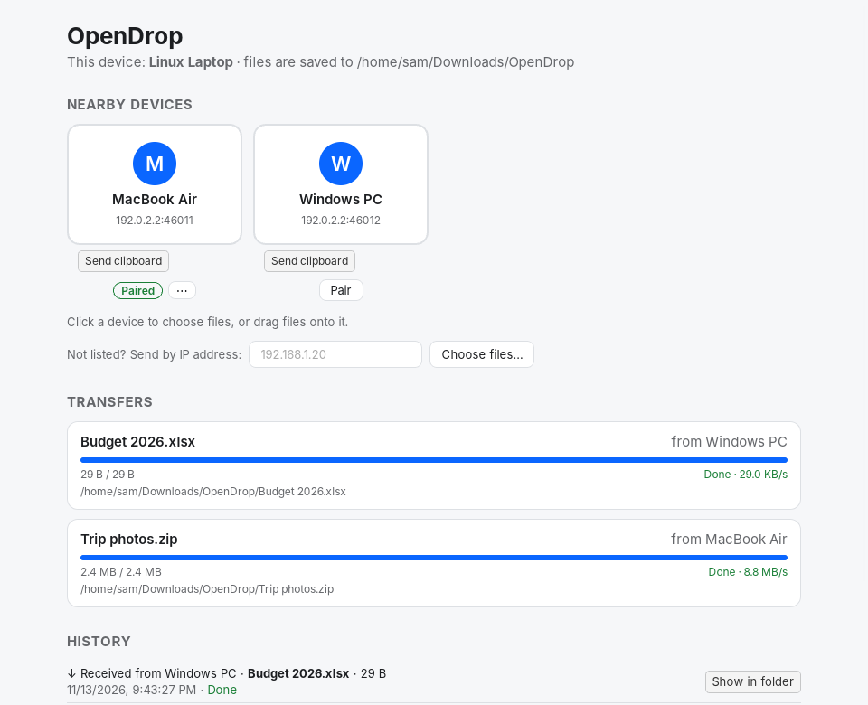
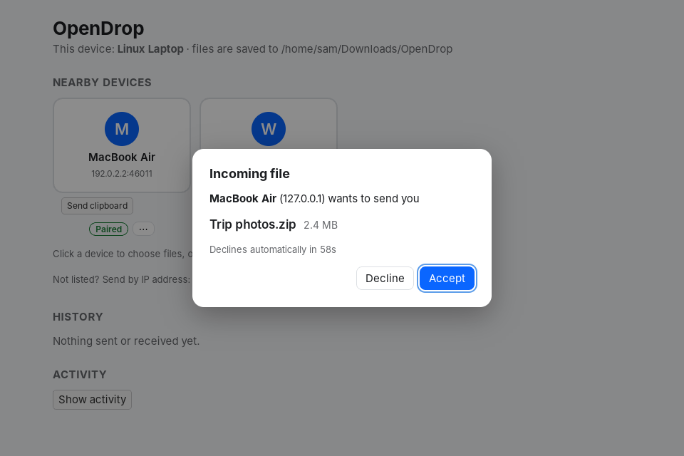
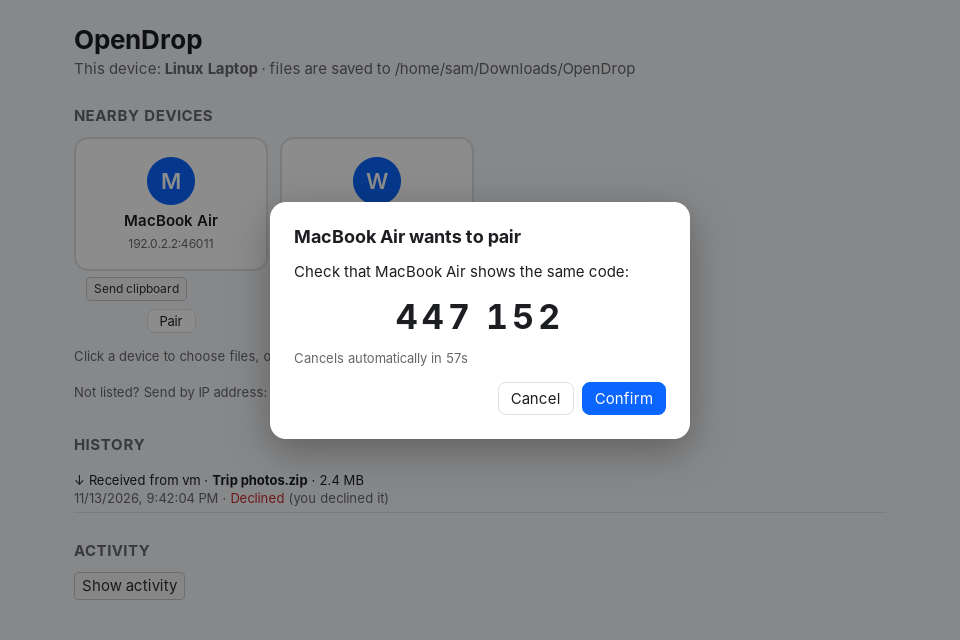

# OpenDrop

Cross-platform, AirDrop-style file sharing over the local network (macOS, Windows, Linux).
No accounts, no cloud: every device runs the same app and talks directly to its peers.

**Status:** pairing, sharing and fetching work, from the CLI, the desktop app and AI assistants (MCP). Devices find each other on the
local network over mDNS and send each other messages and files over TCP, by device name or IP
address. Files are verified with SHA-256 before they're saved.

<p align="center">
  
</p>

## Install

Download the installer for your system from the
[latest release](https://github.com/AJChaikovsky/OpenDrop/releases/latest):

| System | File | Notes |
|---|---|---|
| macOS (Apple silicon and Intel) | `OpenDrop_<version>_universal.dmg` | Open it and drag OpenDrop to Applications. |
| Windows 10/11 | `OpenDrop_<version>_x64-setup.exe` (or the `.msi`) | Run it; no admin rights needed for the `.exe`. |
| Linux (Debian/Ubuntu) | `OpenDrop_<version>_amd64.deb` | `sudo apt install ./OpenDrop_<version>_amd64.deb` |
| Linux (any) | `OpenDrop_<version>_amd64.AppImage` | `chmod +x` it, then run it. |

The builds aren't code-signed yet, so the first launch needs one extra step:

- **macOS:** right-click OpenDrop in Applications, choose **Open**, then **Open** again. If
  macOS says the app "is damaged", run `xattr -cr /Applications/OpenDrop.app` once.
- **Windows:** if SmartScreen says "Windows protected your PC", click **More info**, then
  **Run anyway**.

Then:

1. Open OpenDrop on two devices on the same Wi-Fi or wired network. Each lists the other
   within a few seconds.
2. Drag a file onto the other device (or click it and pick one).
3. Press **Accept** on the other device. The file lands in `Downloads/OpenDrop`.

The first time, your system may ask whether OpenDrop can use the local network (macOS) or
get through the firewall (Windows): allow it, or the devices can't see each other. On
Windows, allow it for the network type you're on (Private or Public).

| Accepting a file | Pairing with a code |
|---|---|
|  |  |

To build it yourself instead, see [Desktop app](#desktop-app).

## Desktop app

`app/` is a Tauri 2 + React + TypeScript app on top of the same crate. It lists nearby
devices, sends files you pick (click a device) or drag onto a device, asks before saving
each incoming file (Accept / Decline, declined automatically after 60 s), and shows progress
and speed on both ends. Received files go to `Downloads/OpenDrop`. It talks to the CLI too.

Click **Pair** under a device to pair with it: both screens show the same 6-digit code, and
pairing only completes once both people press Confirm (Cancel, or 60 s without an answer,
leaves both unpaired). Paired devices get a **Paired** badge; **Unpair** is in the device's
`⋯` menu, and the other device drops its badge the next time the two connect (the app
connects right away when the device is on the network).

You need Rust and Node 18+ (on Windows, WebView2, which Windows 11 ships with):

```bash
cd app
npm install
npm run tauri dev
```

`npm run tauri build` makes an installable app. `npm test` runs the UI tests and
`cargo test -p opendrop-app` the app backend's. To run two copies on one machine, start the
second with `OPENDROP_NAME`, `OPENDROP_DIR` and `OPENDROP_CONFIG_DIR` set (the last gives
it its own key); it picks a free port if 45454 is taken.

## Try it

You need Rust (`rustup.rs`). On the receiving machine:

```bash
cargo run -- listen
```

It advertises itself on the local network, prints the address other devices can use (e.g.
`192.168.1.20:45454`), and lists nearby OpenDrop devices as they appear and disappear. On
another machine, see who's around and send by name:

```bash
cargo run -- peers
cargo run -- send "AJ's MacBook" "hello from my PC"
```

Send files the same way (one or more per command, with live progress):

```bash
cargo run --release -- send-file "AJ's MacBook" photo.jpg notes.pdf
```

The receiver saves them to `~/Downloads/OpenDrop` (change with `listen --dir DIR`). Existing
files are never overwritten: a second `photo.jpg` becomes `photo (1).jpg`. A folder goes as
one transfer with one approval ("the folder "Photos" (500 files, 1.2 GB)"), and its tree is
recreated under the download folder (`Photos`, or `Photos (1)` if that exists). Symbolic links
inside it are skipped. Press Ctrl+C during a send to cancel it: the receiver is told and keeps
nothing.

The receiver is asked about every file before anything is written:

```text
? "AJ's MacBook" (192.168.1.53) wants to send you "photo.jpg" (2.1 MB).
  Accept? [y/N] (within 60s):
```

Anything but `y`/`yes`, or no answer within 60 seconds, declines it; the sender is told and
moves on to its next file. `listen --auto-accept` skips the question (handy for scripted
tests, not for everyday use).

Names match case-insensitively; a device id (`device-1a2b3c4d`) works too. An IP still works:

```bash
cargo run -- send 192.168.1.20 "hello from my Mac"
```

Both on one machine? Use two terminals and give the second listener another port
(`--port 45455`, or `--port 0` to let the OS pick) and its own `--config DIR`.

### Identity and pairing

Each device has an Ed25519 key, made on first start and kept in its config folder
(`identity.key`, readable only by you): `~/Library/Application Support/OpenDrop` on macOS,
`%APPDATA%\OpenDrop` on Windows, `~/.config/OpenDrop` on Linux, or `OPENDROP_CONFIG_DIR` /
`--config DIR`. The device id (`device-` plus 16 hex digits) is derived from the public key,
so it stays the same across restarts; deleting the key file gives the device a new id.

Pair two devices once so each remembers the other's key:

```bash
cargo run -- pair "AJ's MacBook"      # on one device, with `listen` running on the other
```

Both terminals show the same code and ask `Does "..." show the same code? [y/N]`; only if
both answer `y` within 60 seconds are they paired. Then:

```bash
cargo run -- devices                  # Paired / Unpaired / Incompatible, plus offline paired devices
cargo run -- unpair "AJ's MacBook"    # forget it; the other side follows on the next connection
```

Paired devices are stored in `paired-devices.json` next to the key. If that file is damaged,
`listen` warns and carries on with nothing paired (leaving the file alone), while `pair`,
`devices` and `unpair` stop and say which file to fix or delete.

### Sharing and fetching

Instead of sending, a paired device can ask for a file. Nothing is shared until you say so:

```bash
cargo run -- share add ~/Documents/Reports   # on the owner (share list / share remove too)
```

Then, on the other device, with its own `listen` running (the file comes back to it):

```bash
cargo run -- files "AJ's MacBook"                       # what it shares with you
cargo run -- fetch "AJ's MacBook" q3-report.pdf --reason "for the board deck"
```

The owner is asked every time, with the reason, and nobody answering within 60 seconds
declines it:

```text
? Fetch request: "PC" (192.168.1.177) asks for your shared file "q3-report.pdf" (2.1 MB).
  Reason given: "for the board deck"
  Send it? [y/N] (within 60s):
```

A file can be named by its name, its path in the share (`Reports/2026/q3.pdf`) or its id
from `files`. Only paired devices can list or fetch, and each device may list at most 30
times a minute; `listen --allow-unpaired-fetch` lifts the pairing rule for local demos and
prints a warning. Every listing, request, approval, decline, folder grant and send is appended to `audit.log`
in the config folder (one JSON object per line; names and decisions, never file contents).
`opendrop audit` prints it, and the app shows it under *Activity*.

The desktop app also keeps a transfer history: every file or folder it sent or received,
with the time, the other device, the size, how it ended (done, declined, failed or
cancelled) and where a received item was saved, which *Show in folder* opens. It lives in
`history.jsonl` in the config folder, so it survives restarts.

Closing the app's window keeps OpenDrop running in the menu bar (macOS) or the system tray
(Windows, Linux): it stays discoverable and keeps receiving. When a file, folder, fetch
request or pairing code needs an answer, a notification appears and the window comes back
with the question. Click the icon (or the Dock icon on macOS) to open the window, or pick
*Quit OpenDrop* from its menu to stop. If the terminal's `opendrop listen` and the app run
on one computer, other devices list it once, under the same name.

To send from the file browser, turn on *Right-click menu → Add to the menu* in the app.
Then right-click any files or folders and choose **Send with OpenDrop**. On macOS it is
under *Quick Actions* (or *Services*), and on Windows 11 under *Show more options*. The app
window comes up and asks which device to send them to. On Windows this adds entries under
`HKCU\Software\Classes` (no admin needed). On macOS it adds
`~/Library/Services/Send with OpenDrop.workflow`. *Remove from the menu* takes them away.

**Send clipboard** on a device card offers the text on your clipboard. The other device
shows the text and asks first; *Accept and copy* puts it on that device's clipboard.
Clipboard text has to fit in one protocol message (about 64 KB). Anything longer is
refused with a message saying to send it as a file.

When you approve a fetch you can also let that device fetch from the same folder (and its
subfolders) for 10 minutes without asking: answer `a` in the terminal, or tick the box in the
app. Grants are kept in memory only, per device and folder; asking each time stays the default.
Hidden files, the download folder and anything a symlink would reach
outside a shared folder are never shared. `--auto-accept` does not approve fetches.
`opendrop transfers` lists what the running `listen` has sent and received; it and `files` /
`fetch` reach it over a local socket (named pipe on Windows) only your user can open. If you
pair with `opendrop pair` while `listen` is running, restart `listen` so it picks the
pairing up.

Options: `--port PORT` (default 45454), `--name NAME` (defaults to the hostname),
`--dir DIR` (where `listen` saves files), `--config DIR` (key and paired devices),
`--auto-accept` (`listen` takes files without
asking) and `--wait SECONDS` (how long `peers`, `send` and `send-file` look for a device by
name; default 3). Use `--release` for large files; debug
builds hash much more slowly.
Run the tests with `cargo test`; `cargo test -- --ignored` also runs a discovery test over
real multicast on this machine.

If the connection times out between two machines, check that both are on the same network
and that the receiver's firewall allows incoming connections on port 45454 (macOS will
prompt the first time; on Windows allow it in the Defender dialog). If `peers` finds nothing,
the network may block multicast (common on guest and corporate Wi-Fi, and with some VPNs);
sending by IP still works.

## Relay (preview, opt-in)

The relay is the first piece of the "send to my assistant" inbox (Phase 9, option B in
[the design doc](docs/design/ai-file-requests.md)). It's off unless you sign in, and the
local-network sharing above never uses it. Today it only shows which of your devices are
online from anywhere; the inbox and the claude.ai / ChatGPT connector come next.

Run a relay yourself:

```bash
cargo run -p opendrop-relay -- --bind 0.0.0.0:8787 --public-url http://<this machine's IP>:8787
```

Then on each device:

```bash
opendrop relay login you@example.com --relay http://<relay IP>:8787
# open the sign-in link (for now the relay prints it in its own window instead of emailing it)
opendrop listen          # stays connected to the relay while it runs
opendrop relay status    # your devices, online or offline
opendrop relay logout    # stop using the relay
```

Devices prove who they are with the same key they use for pairing, so a device can't be
impersonated on the relay, and the relay never sees file contents in this stage.

## Use it from an AI assistant (MCP)

`opendrop mcp` lets Claude Code, Claude Desktop or any other MCP client get files from your
other devices: "get the Q3 report from my MacBook". The assistant only sees files the owner
shared, and the owner approves every request on their own screen, with the assistant's
stated reason.

```text
assistant ──MCP (stdio)──> opendrop mcp ──local socket──> opendrop listen / the app ──LAN──> other device
```

**1. Install OpenDrop on both devices.** From a clone of this repo:

```bash
cargo install --path .        # puts `opendrop` in ~/.cargo/bin
```

**2. On the device that has the files**, share a folder (nothing is shared by default) and
keep OpenDrop running, either `opendrop listen` or the desktop app:

```bash
opendrop share add ~/Documents/Reports
opendrop listen
```

**3. Pair the two devices once**, if you haven't: `opendrop pair "<other device>"` with
`listen` running on the other one (or the app's **Pair** button).

**4. On the device the assistant runs on**, keep `opendrop listen` (or the app) running too:
fetched files arrive through it, in `Downloads/OpenDrop`.

**5. Add the server to your assistant.**

Claude Code:

```bash
claude mcp add --scope user opendrop -- opendrop mcp
claude mcp list               # opendrop: opendrop mcp - ✓ Connected
```

`--scope user` makes it available in every folder; without it, Claude Code only offers the
server in the folder where you ran the command.

Claude Desktop: open **Settings → Developer → Edit Config** (the file is
`~/Library/Application Support/Claude/claude_desktop_config.json` on macOS,
`%APPDATA%\Claude\claude_desktop_config.json` on Windows), add the server with the full
path to the binary (Claude Desktop doesn't search your `PATH`), and restart Claude Desktop:

```json
{
  "mcpServers": {
    "opendrop": {
      "command": "/Users/you/.cargo/bin/opendrop",
      "args": ["mcp"]
    }
  }
}
```

On Windows the command is `"C:\\Users\\you\\.cargo\\bin\\opendrop.exe"`. The tools menu (the
slider icon under the message box) then lists `opendrop` with six tools.

**Try it:**

- "What devices can OpenDrop see?"
- "Which files does my MacBook share?"
- "Get notes.txt from my MacBook and summarize it." The owner sees an approval prompt;
  once they approve, the assistant reads the file.

| Tool | What it does |
|---|---|
| `list_devices` | Nearby and paired devices, with `online`, `paired`, `compatible` |
| `list_shared_files` | What a device shares: `file_id`, name, path in the share, size, type |
| `request_file` | Asks the owner for one shared file, with a reason; returns a `transfer_id` at once |
| `get_transfer_status` | `awaiting_approval` → `transferring` → `done` (or `declined`, `failed`, `cancelled`); can wait up to 30 s. When done: the saved path, and small text files or images inline |
| `send_file` | Sends a file from this computer to a paired device, whose user accepts it as usual; returns a `transfer_id` at once |
| `cancel_transfer` | Stops a request or a transfer under way |

Errors come back as tool errors with a code the assistant can act on: `daemon_not_running`
(start `opendrop listen` or the app), `unknown_device`, `device_offline`, `not_paired`,
`not_shared`, `ambiguous_file`, `unknown_transfer`, `rate_limited`, and for `send_file`
`path_not_allowed` (relative, hidden, or OpenDrop's own keys) and `not_a_file`. There is no way to ask for a path: a
request for anything not in the share list ends in `not_shared` with nothing sent. If you
start OpenDrop with `--config DIR`, pass the same to the server: `opendrop mcp --config DIR`.

## Layout

| Path | Responsibility |
|---|---|
| `src/main.rs` | CLI: `listen`, `peers`, `send`, `send-file`, `pair`, `devices`, `unpair`, `share`, `files`, `fetch`, `transfers`, `audit` and `mcp` |
| `src/daemon/` | What `listen` and the app run: listener, discovery, transfer table, fetches |
| `src/control/` | Local control API (Unix socket / named pipe) for the CLI, the app and the MCP server |
| `src/mcp/` | `opendrop mcp`: the MCP server and its six tools |
| `src/share/` | Share allowlist, opaque file ids and safe path resolution |
| `src/lib.rs` | Library root, so the Tauri app can reuse everything later |
| `src/protocol/` | Message types, versioning, length-prefixed framing |
| `src/identity.rs` | The device key pair, its file, and the device id derived from it |
| `src/network/handshake.rs` | Signed handshake: proves each side holds its key, agrees on encryption keys |
| `src/network/secure.rs` | The encrypted channel every connection switches to after the handshake |
| `src/network/limit.rs` | Per-device rate limit (share listings) |
| `src/network/grants.rs` | Time-limited folder grants given on a fetch approval |
| `src/audit.rs` | The append-only audit log behind `opendrop audit` and the app's Activity view |
| `src/pairing/` | Pairing protocol and 6-digit code; `store.rs` keeps paired devices |
| `src/network/server.rs` | Accepts connections, one Tokio task per peer |
| `src/network/client.rs` | `Connection`: connects to a peer, sends texts and files, lists shares, requests fetches |
| `src/network/fetch.rs` | Fetches this device started, which decide which offers skip the prompt |
| `src/discovery/` | mDNS advertising, browsing and the discovered-peer table |
| `src/transfer/` | Chunked streaming with SHA-256, temp files, safe file names |
| `app/src-tauri/src/background.rs` | Tray / menu bar icon, close-to-hide, and notifications for questions while hidden |
| `app/src-tauri/src/context_menu.rs` | "Send with OpenDrop": the Explorer entries and the Finder Quick Action |
| `app/src-tauri/src/history.rs` | The desktop app's transfer history (`history.jsonl`) and *Show in folder* |
| `app/src-tauri/src/node.rs` | Desktop app backend: receive with approval, send, pair, progress and speed events |
| `app/src-tauri/src/lib.rs` | Tauri commands and event forwarding |
| `app/src/` | React UI: device list, drop targets, accept and pairing dialogs, transfers |

## Protocol (v3)

Each control message is one frame: a 4-byte big-endian length followed by that many bytes of
UTF-8 JSON (inside the encrypted channel once the handshake is done). Frames over 64 KiB are
rejected before any allocation. Every message carries
`version` and `type`:

```json
{"version": 3, "type": "text", "body": "hi"}
```

Keys, nonces and signatures travel as lowercase hex.

| Type | Direction | Fields |
|---|---|---|
| `hello` | client to server, first message | `device_id`, `device_name`, `public_key`, `nonce`, `ephemeral` |
| `welcome` | server reply to `hello` | `device_id`, `device_name`, `public_key`, `nonce`, `ephemeral`, `paired`, `signature` |
| `hello_proof` | client reply to `welcome` | `paired`, `signature` |
| `ready` | server, once the proof checks out | |
| `pair_request` | client | `commitment` (SHA-256 of its pairing nonce) |
| `pair_nonce` | server reply | `nonce` |
| `pair_reveal` | client | `nonce` (the committed one) |
| `pair_accept` / `pair_decline` | each side, exactly once | `pair_decline` has `timed_out` |
| `text` | client to server | `body`; with `transfer_id` it is clipboard text the receiver must approve |
| `text_ack` | server reply to `text` (for clipboard text: accepted) | `received_bytes` |
| `file_offer` | client to server | `transfer_id`, `name` (bare file name), `size` |
| `file_accept` | server reply to `file_offer` | `transfer_id` |
| `file_decline` | server reply to `file_offer` or clipboard `text`; connection stays open | `transfer_id` |
| `file_done` | client, after the raw bytes | `transfer_id`, `sha256` (lowercase hex) |
| `file_received` | server, once verified and saved | `transfer_id`, `received_bytes` |
| `share_list_request` | requester to owner (paired only) | `query` (optional, matches paths ignoring case) |
| `share_list` | owner reply | `files: [{file_id, name, path, size, modified}]`, cut to fit one frame, `truncated` |
| `fetch_request` | requester to owner | `fetch_id`, `file_id`, `reason`, `via_assistant`, `reply_port` |
| `fetch_accepted` | owner reply, once its user said yes | `fetch_id` |
| `fetch_declined` | owner reply | `fetch_id`, `reason` (`declined`, `timeout`, `not_shared`, `not_paired`) |
| `fetch_offer` | owner to requester, on a new connection | like `file_offer`, plus `fetch_id` |
| `error` | either, then close | `code` (`unsupported_version`, `unexpected_message`, `bad_message`, `file_rejected`, `checksum_mismatch`, `storage_error`, `identity_mismatch`, `pairing_failed`, `not_paired`, `rate_limited`), `message` |

A peer with a different `version` gets an `unsupported_version` error rather than a parse
failure. Reads time out after 10 seconds so a stalled peer can't hold a connection open.

### Handshake

Each side signs a transcript of both public keys and both fresh nonces (plus its `paired`
flag): the server in `welcome`, the client in `hello_proof`. Since each signature covers a
nonce the other side just picked, old signatures can't be replayed, and copying a device's
id or public key is useless without its private key. The device id must also be the
fingerprint of the presented key, and a paired device must present the key stored for it.
Any failure ends the connection with `identity_mismatch` before anything else is read. The
`paired` flags keep pairing in sync: if one side unpaired, the other forgets it too.

### Encryption

Since protocol v3, `hello` and `welcome` also carry a fresh X25519 key (`ephemeral`), and the
signatures cover both. After `ready`, everything on the connection, the messages and the file
bytes alike, goes through an encrypted channel: HKDF-SHA256 over the X25519 result, salted with
a hash of the whole handshake, gives one ChaCha20-Poly1305 key per direction. Each record is a
4-byte length (authenticated) followed by ciphertext and a 16-byte tag, with a per-direction
counter as nonce, at most 64 KiB of plaintext. A device in the middle can't swap in its own key
without breaking a signature, a changed, replayed, reordered or cut record fails to decrypt, and
since the X25519 keys are thrown away after the handshake, a device key stolen later can't
decrypt a recorded connection. The handshake itself (names, device keys, nonces) stays
readable. A device that isn't paired can still send files, but the prompt marks it
*unverified*: anyone could have picked that name.

We chose this signed-ephemeral design (as in TLS 1.3 and SIGMA) over Noise XX or TLS with
pinned keys because the devices already authenticate with Ed25519 keys in the v2 handshake:
adding an ephemeral key to the signed transcript gives the same guarantees with two small, well
reviewed crates (`x25519-dalek`, `chacha20poly1305`) and no certificates or second key type to
manage.

### Pairing

After the handshake, the client sends a commitment to a random nonce, the server answers with
its own nonce, and the client reveals its nonce. Both sides then show a 6-digit code hashed
from both keys and all four nonces and ask their user. Because the client commits first and
the server answers before the reveal, a man in the middle can't pick nonces that make the
codes on the two real screens match. Each side sends one `pair_accept` or `pair_decline`; a
decline withdraws the other side's prompt. Both store each other only if both accepted
within 60 seconds.

### File transfer

The receiver answers each `file_offer` only once its user has decided (the sender waits up
to 70 seconds). The receiver can report progress and the saved path through
`server::run_with_events`, which the desktop app uses. After `file_accept`, the sender writes exactly `size` bytes of file content straight onto the
socket (unframed, in 64 KiB chunks), then a `file_done` frame. The receiver strips any
directory parts and unsafe characters from `name` and streams the bytes into a hidden
`.opendrop-*.part` file in the download folder, hashing as it goes. Only if its SHA-256
matches `file_done` is the file synced and renamed into place, then confirmed with
`file_received`. On a mismatch, a dropped connection or a stall, the temp file is deleted.
Several files (and texts) can be sent over one connection, one after another.

A folder starts with `folder_offer` (name, file count, total size) and its listing in
`folder_entries` frames (paths relative to the folder, `/`-separated, each checked: no `..`,
`.`, empty parts, absolute paths, drive letters, backslashes, Windows-reserved names or
characters, duplicates, or more than 100,000 files or 64 levels). An unsafe listing gets
`error` `file_rejected` before the user is even asked. After `file_accept`, each file goes in
listing order as its raw bytes and a `file_done`. The receiver writes them into a hidden
`.opendrop-*.partdir` folder and renames it into place only after the last one checks out;
anything else deletes the whole folder. Both sides report a tree SHA-256 over each file's hash
and path.

Either side can cancel midway. The receiver sends `cancel`. The sender, whose side of the
stream is raw file bytes at that point, sends an empty encrypted record instead, which no
other message produces. Both ends delete the partial file or folder and report `cancelled`,
saying which side did it.

### Fetching

Fetching flips the flow: the device that wants a file asks for it. A paired requester can
list the owner's shared files (`share_list_request`); files are named by opaque `file_id`s,
never paths. A `fetch_request` names one id, the requester's stated reason, and the port of
its own listener. The owner's user is asked (with the reason, and whether an AI assistant
asked); after 60 seconds without an answer the request is declined with `timeout`. On a yes
the owner replies `fetch_accepted`, connects back to the requester's address on
`reply_port`, checks in the handshake that it reached the same device, and sends the file
with the usual transfer sequence, opening with `fetch_offer` instead of `file_offer`. The
requester takes a `fetch_offer` without asking only if its `fetch_id`, the sending device and
the size all match a fetch it started; anything else gets the normal accept prompt. Fetches
reuse the SHA-256 check and `.part` handling of ordinary transfers.

## Discovery

Each device advertises one `_opendrop._tcp.local.` instance named after its device id, on its
TCP port, with TXT properties `device_id`, `device_name` (cut to 200 bytes) and
`protocol_version` (`3`). Virtual adapters (WSL and Hyper-V `vEthernet`, Docker, VMs, VPNs,
Apple's AWDL) are left out of the advertisement, since other devices can't reach them, and a
peer's addresses on a network this device is also on are tried first. It browses for the same service type at the same time, ignores its
own instance, adds peers when they resolve and drops them when their instance is removed
(`listen` unregisters on Ctrl+C, so peers see it leave right away). A peer advertising a
different `protocol_version` is still listed, marked incompatible.
